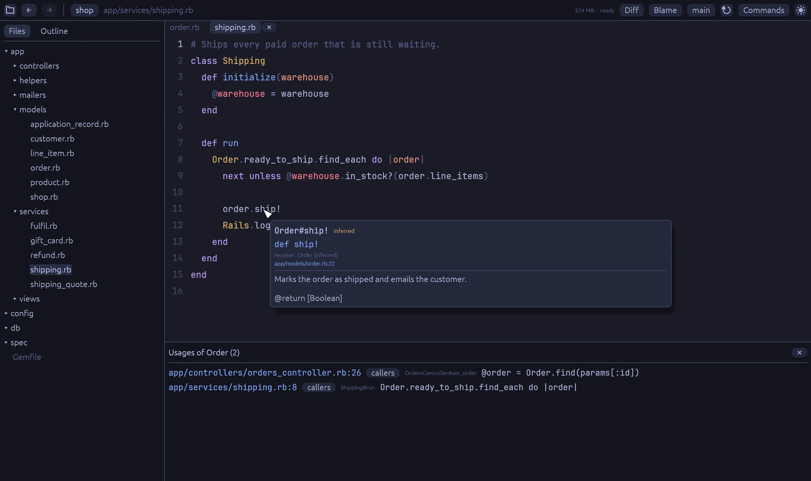

# Rubyscope

**Website:** https://rubyscope.equivalent.work
**Docs:** https://rubyscope.equivalent.work/docs/

Rubyscope is a small desktop app for reading Ruby on Rails code. Hold Ctrl
(Cmd on macOS), click a name, and you land on the line where it is defined.



It works on classes and methods, and also on the things a text search gets
wrong in a Rails app: route helpers, translation keys, partials, the view of
a controller action, RSpec `let`s and FactoryBot factories. It follows
Ruby's real lookup rules, so `order.ship!` opens `Order#ship!`, not every
`ship!` in the project.

I built it because I read large Rails apps all day and wanted
go-to-definition as good as RubyMine's, in a small app that starts in about
a second. It is written in Rust and runs on Omarchy Linux and macOS.

Rubyscope only reads your code. It is not an editor, not a language server,
and it never runs your app. To change a file, open it in your editor from
the right-click menu.

> This is alpha software (0.0.1). Expect rough edges.

## Install

Download the Linux or macOS build from the
[GitHub releases](https://github.com/equivalent/rubyscope/releases).

**Linux** (x86_64):

```
tar xzf rubyscope-0.0.1-linux-x86_64.tar.gz
rubyscope-0.0.1-linux-x86_64/install.sh
```

This puts `rubyscope` and `rubyscope-cli` in `~/.local/bin`, plus an app
launcher entry and the icon. Make sure `~/.local/bin` is on your `PATH`.

**macOS** (Apple silicon): open the `.dmg` and drag Rubyscope to
Applications. The app is not signed yet, so run this once before the first
start:

```
xattr -dr com.apple.quarantine /Applications/Rubyscope.app
ln -sf /Applications/Rubyscope.app/Contents/MacOS/rubyscope ~/.local/bin/rubyscope
```

### Build it yourself

You need Rust 1.88 or newer, and clang with libclang (the Prism parser is C).

```
bin/install          # Linux
bin/install-macos    # macOS
```

## Use it

```
rubyscope ~/code/shop                            # open a project
rubyscope ~/code/shop/app/models/order.rb:40     # open a file at a line
rubyscope                                        # the project list
```

The first start indexes the project in the background, which takes a few
seconds on a large app. After that it starts in about a second.

The keys you will use most:

| Key | What it does |
|---|---|
| Ctrl+click | Go to the definition |
| Ctrl+P | Go to file |
| Ctrl+T | Go to a class, method or constant |
| Ctrl+Shift+F | Search in all files |
| Ctrl+K | All commands |
| Ctrl+B | Git blame |
| Ctrl+Shift+D | Diff mode: what your branch changed |
| Mouse back and forward | Go back and forward |

Right-click a name for "Find usages", the type hierarchy, "Open in editor"
and "Open on GitHub". Rest the pointer on a name to see its signature and
docs.

Every key, every mouse action, diff mode, branches and settings are in
**[the docs](https://rubyscope.equivalent.work/docs/)**. Keys can be changed
in `~/.config/rubyscope/keys.toml`
([how](https://rubyscope.equivalent.work/docs/#change-keys)).

### Nice to have

Rubyscope works without these, but does more with them:

- **ruby and installed gems**, so a click can go into gem source. It finds
  the project's Ruby through mise or rbenv.
- **git**, for blame and diff mode.
- **gh**, the GitHub CLI, so a blame click opens the pull request and the
  branch list shows who opened each one.
- **Omarchy**, whose theme colors Rubyscope uses.

### Open a file from a link

A `rubyscope://` link opens a file at a line, from a browser, a chat or a
report:

```
rubyscope://open?repo=shop&path=app/models/order.rb&line=40
rubyscope://open?file=/abs/path/to/shop/app/models/order.rb&line=40
```

With `repo=`, Rubyscope looks for the file in `~/git/<repo>`, so the same
link works on every computer. `bin/install` makes Rubyscope the handler of
these links on Linux. On macOS, run `rubyscope '<link>'` from a terminal for
now.

Rubyscope treats a link as untrusted. It runs nothing from it, and refuses
a link whose line is not a number, whose file is missing, or whose path
leaves `~/git/<repo>`.

## How it works

Rubyscope reads the source and never boots Rails, so it also works on an
app that does not start.

1. It lists the project files (respecting `.gitignore`) and the installed
   gems from `Gemfile.lock`.
2. It parses every Ruby file with Prism, on all CPU cores.
3. It links everything into one index, with the rules of Ruby, Rails,
   RSpec, FactoryBot and Stimulus on top.
4. It saves the index to `~/.cache/rubyscope/`, so the next start parses
   only the files that changed.
5. A file watcher keeps the index up to date while the window is open.

Some things cannot be found by reading code, such as a `define_method` with
a name built at runtime. Then Rubyscope lists every method with that name
and tells you it is a guess. It never guesses in silence. More in
[Limits](https://rubyscope.equivalent.work/docs/#limits).

## Working on Rubyscope

Run every check before a push:

```
bin/ci
```

It runs `cargo fmt --check`, clippy with warnings as errors, all tests
(including the window tests), a Ruby syntax check of the probe, and a check
for private local paths. A push to `main` runs it by itself through the
pre-push hook. Turn the hook on in a new clone with
`git config core.hooksPath .githooks`.

The code is in three crates:

- `crates/index`: the index, with no window. Finds files, parses, links,
  answers clicks, saves the index.
- `crates/app`: the window, built with egui.
- `crates/cli`: `rubyscope-cli`, for testing the index without the window.

Other folders:

- `probe/`: a script that asks a booted Rails app where things really are.
- `webpage/`: the website and the docs, plain HTML and CSS.
- `plans/`: the design plan.
- `bin/`: install, package, release and CI scripts.

### Test the index from the terminal

`rubyscope-cli` builds the same index as the window. Positions are
`FILE:LINE:COL`, starting at 1.

```
rubyscope-cli -r ~/code/shop index                       # build it, print counts and times
rubyscope-cli -r ~/code/shop def app/models/order.rb:12:5    # where a click goes
rubyscope-cli -r ~/code/shop refs app/models/order.rb:12:5   # every usage
rubyscope-cli -r ~/code/shop hover app/models/order.rb:12:5  # what the popup shows
rubyscope-cli -r ~/code/shop golden clicks.txt           # golden click tests
```

`--no-gems`, `--no-stdlib` and `--no-cache` skip parts of the index. Run
`rubyscope-cli --help` for all commands.

A golden file has one click per line, and the line it should land on:

```
app/controllers/orders_controller.rb:12:5 => app/models/order.rb:1   # a note
```

### Compare with a booted Rails app

The probe runs inside your app and writes where every constant and method
really is. It only reads, and it works without a database.

```
cd ~/code/shop
bin/rails runner ~/git/rubyscope/probe/rails_probe.rb /tmp/probe.json
rubyscope-cli -r ~/code/shop check /tmp/probe.json
```

### Releases

`bin/package` builds the release file for the current OS into `dist/`.
`bin/release <version>` does a whole release on Linux and a Mac. Read the
top of the script for what it needs.

## License

MIT. See [LICENSE](LICENSE).
